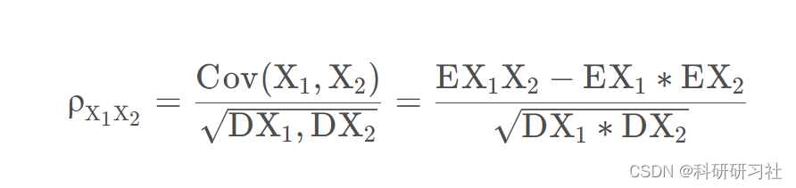
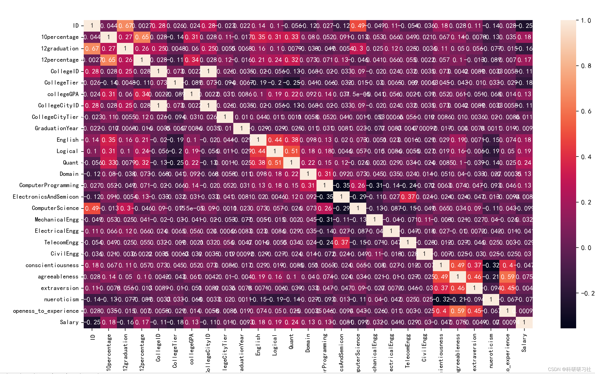
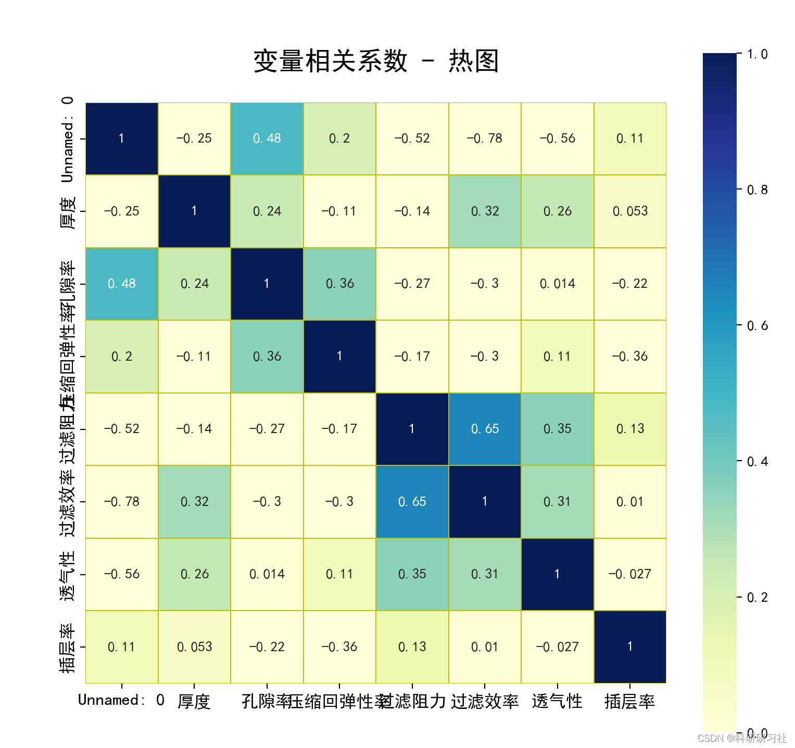

# Correlation Heatmap Analysis (Python & Matlab Code Implementation)

​  
1. Heatmap 1.1 Introduction: The heatmap can be used to observe the similarity between multiple features in a data table.
Seaborn's heatmap is a heatmap that is commonly used to display a correlation matrix of a set of variables, the distribution of data in a contingency table. Through the heatmap, we can intuitively see the differences in the given numerical values.
Heatmap Also known as a correlation coefficient plot. Based on the correlation coefficients of different squares in the heatmap. It is possible to determine the degree of correlation between variables. The formula for calculating the correlation coefficient between two variables is:
Editor
In the formula, ρ represents the correlation coefficient, Cov denotes the covariance, and E stands for the mathematical expectation/mean.
It is important to note that the correlation coefficient can only measure the linear correlation between variables; that is, the higher the correlation coefficient, the stronger the linear correlation between variables. For two variables with a low correlation coefficient, it only indicates a weak linear correlation between them, but it does not mean that there are no other correlations, such as curved relationships, between the variables.
1.2 Syntax seaborn.heatmap(data, *, vmin=None, vmax=None, cmap=None, center=None, robust=False, annot=None, fmt='.2g', annot_kws=None, linewidths=0, linecolor='white', cbar=True, cbar_kws=None, cbar_ax=None, square=False, xticklabels='auto', yticklabels='auto', mask=None, ax=None, **kwargs)\n  
======== (1)Heatmap input data parameters=======data: Specifies the dataset for drawing a heatmap. The heatmap is drawn based on the values passed in data, typically a two-dimensional matrix.======== (2)Heatmap matrix block color parameters=======vmin, vmax: Used to specify the display values of the minimum and maximum values in the legend.cmap: Specifies an object of colormap, used for filling the heatmap.center: Specifies the value of the color center, through which the color depth of the heatmap can be adjusted.robust: Default value is False;If False and vmin and vmax are not set, the color range of the heatmap is set according to the robust quantiles, not using extreme values======== (3)Heatmap matrix block annotation parameters============annot: Specifies a bool value or an array with the same shape as the data parameter. If True, numbers are displayed on each cell of the heatmapfmt: Specifies the display format of the data in the cell.annot_kws: Other attributes describing the label of the number in the cell, such as colorSize Equals========= (4)Heatmap matrix block spacing and line parameters==============linewidths: Specifies the border width of each celllinecolor: Specifies the border color of each cell========= (5)Heatmap color scale bar parameters==============cbar: bool type parameter, whether to use a color bar as a legend, default is Truesquare: bool type parameter, whether to make each cell in the heatmap square,Default is False.cbar_kws: Description of other attributes related to color bars========= (6) X-axis and Y-axis =================== xticklabels, yticklabels: Specify the tick labels for the x-axis and y-axis of the heatmap, if True, then use the variable names of the data frame and row names as the tick labels mask: Used to highlight certain data ax: Used to specify the position of the subfigure  
2.2 PythonCode\n'''=========Import relevant libraries============='''\nimport pandas as pd\nimport seaborn as sns\nfrom matplotlib import pyplot as plt\nplt.rcParams['font.sans-serif']=['SimHei']  #The image shows Chinese text.\nplt.rcParams['axes.unicode_minus'] =False #Minus signunicodeCoding\n\n#=====Data Reading and Data Preprocessing=============\nshuju=pd.read_csv('Data.csv')\nprint(shuju)\nshuju.isnull().sum()   #Check for any missing values.: \nprint(shuju)\nshuju.describe()  #View data description\n\n#=======Draw heatmap===============\nplt.figure(figsize=(25,20))\nsns.heatmap(shuju.corr() , annot=True)  #shuju.corr() : Calculate the correlation coefficients between various variables.\n# Set the font size of the scale\nplt.xticks(fontsize=9)\nplt.yticks(fontsize=9)\nplt.show()\n  
2.3 Running Results Editing
For Examples 2 and 4, data and code can be downloaded by clicking the link:
3. The Python code implementation of Example 2 is excellent and worth learning:
Data Visualization - Heatmap & Correlation Map (Principle + Python Code)
4. The Python code implementation of Example 3 comes from the 2022 Hua Shu Cup competition.
4.2 PythonCode'''======Import third-party library========'''\nimport pandas as pd\nimport seaborn as sns\nimport matplotlib.pyplot as plt\nplt.rcParams['font.sans-serif'] = ['SimHei']  # Specify the default font\nplt.rcParams['axes.unicode_minus'] = False  # Solving the issue of negative signs in image saving.'-'Displaying as squares,Negative sign is displayed normally\n\n'''=======Reading data==========='''\ndata=pd.read_csv('Heat map analysis.csv', encoding='gbk')\ndata.head()\n\ncorr = data.corr()     # shuju.corr() : Calculate the correlation coefficients between various variables.,corr(method='pearson')Default method selectionpersonRelevance, 'spearman'Rank correlation. If you wish to choose another method, please modify accordingly.meathodParameters. Here we will use Pearson for demonstration purposes.。\n'''=====Heatmap visualization============'''\nplt.subplots(figsize=(9, 9))  # Set the screen size.\n# annot=True, Values on the explicit heatmap; vmaxIt displays the maximum value.;xticklabels, yticklabelsAxial label display; square=True, Turn the image into a square, by default it is a rectangle.; cmap="Blues"It is a pattern, which is the color configuration of the image.。\n# mask:Control whether a certain matrix block is displayed.,Default value isNone,If it's a boolean typeDataFrame, ThenDataFrameOutput:TrueThe position is covered with white.\nsns.heatmap(corr, annot=True, vmax=1, vmin=0, xticklabels=True, yticklabels=True, square=True, cmap="YlGnBu",\n            linewidths=0.05, linecolor='y')  # mask=t < 0.8Equivalent tomask=(t < 0.8)\nplt.title('Variable correlation coefficient - heatmap\n', fontsize=18)  # Adding chart titles“Variable correlation coefficient - heatmap”,fontsize=18 Font size can be omitted.\nplt.xticks(fontsize=12)\nplt.yticks(fontsize=12)\nplt.show()\n  
4.3 Running Results Editing
5 Relevance Analysis (Pearson, Kendall, Spearman) (Matlab Code Implementation) This blogger's summary is quite good and very fruitful:
matlab Relevance Analysis (Pearson, Kendall, Spearman)

## Images

<!-- PAYMENT_BLOCK -->

## Get this dataset

- Payment link (Stripe): [Buy now](https://buy.stripe.com/3cs8yP7sY87d0vu9AB)
- Payment QR code: 

<!-- /PAYMENT_BLOCK -->
